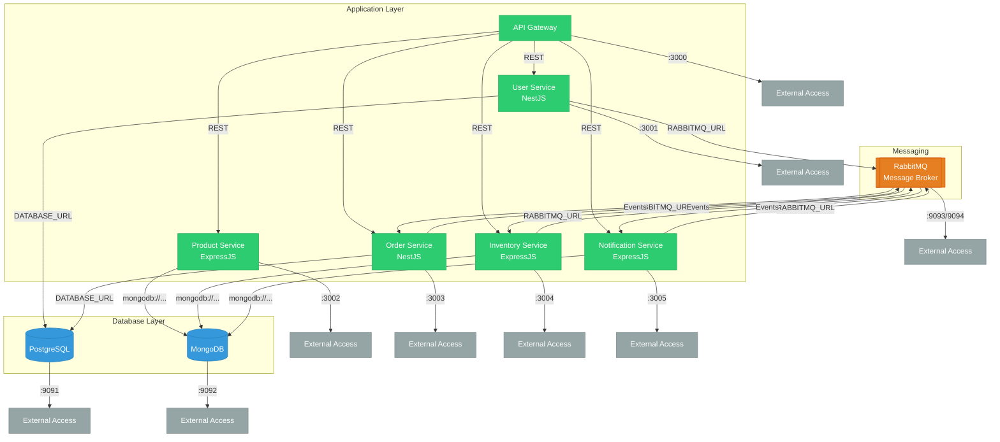

# 🛒 NodeJS Microservices: Order & Inventory System


Scalable and modular microservices architecture built with Node.js (NestJS & ExpressJS), PostgreSQL, MongoDB and Docker. It leverages RabbitMQ for event-driven communication, ideal for modern e-commerce and real-time systems.


---


## ✨ Overview

This project demonstrates a modern microservices architecture for an Order & Inventory System, suitable for real-world companies. Each service is designed with a single responsibility, clear separation, and scalable technologies.

- **Tech Focus:** TypeScript-first, RESTful APIs, event-driven messaging, containerised infrastructure
- **Monorepo:** All services managed together for easy orchestration and development
- **Best Practices:** Security, scalability, and maintainability in mind

---

## 🏗️ Architecture



| Microservice             | Tech Stack       | DB         | Responsibility                                  |
| ------------------------ | ---------------- | ---------- | ----------------------------------------------- |
| **User Service**         | NestJS           | PostgreSQL | User registration, login, authentication, roles |
| **Product Service**      | ExpressJS        | MongoDB    | Product CRUD (create, update, list, delete)     |
| **Order Service**        | NestJS           | PostgreSQL | Order creation, validation, and processing      |
| **Inventory Service**    | ExpressJS        | MongoDB    | Stock tracking, update on orders                |
| **Notification Service** | ExpressJS        | MongoDB    | Email/log notifications on events               |
| **API Gateway**          | ExpressJS/NestJS | -          | Unified API entry, routing, token verification  |
| **Message Broker**       | RabbitMQ    | -          | Inter-service event bus                         |

---

## 📁 Project Structure

```bash
nodejs-microservices/
├── api-gateway/              # API Gateway (routing, auth)
├── user-service/             # User microservice
├── product-service/          # Product microservice
├── order-service/            # Order microservice
├── inventory-service/        # Inventory microservice
├── notification-service/     # Notification microservice
├── docker-compose.yml        # Infrastructure orchestration
├── docs/                     # Architecture diagrams, docs
├── README.md
```

---

## 🔗 Communication

* **API Gateway ⇄ Services:** REST (HTTP)
* **Between Services:** Messaging (RabbitMQ)

  * `OrderService` emits `order_created`
  * `InventoryService` listens and adjusts stock
  * `NotificationService` listens and sends notification

---

## 🚀 Features

### 👤 User Service

* Secure sign up & login
* JWT authentication
* Role-based access (admin/user)

### 🛍️ Product Service

* Create/list/delete products
* Fetch by product ID
* Simple MongoDB schema

### 🛒 Order Service

* Place new orders
* Validate users & product stock
* Emits `order_created` event

### 🏬 Inventory Service

* Listens to `order_created`
* Decreases stock or rejects if insufficient

### 📢 Notification Service

* Listens to events (`order_created`, etc)
* Sends notification (email/log)

### 🌍 API Gateway

* One entry point for frontend
* Reverse proxy, JWT verification
* Routes `/products`, `/orders`, `/users` to services

---

## 🐳 Dockerized Infrastructure

Powered by `docker-compose.yml`:

* All microservices (with build contexts)
* MongoDB, PostgreSQL databases
* RabbitMQ for messaging
* Optional admin UIs: pgAdmin, Mongo Express, RabbitMQ dashboard

### 🧪 Docker Network & Setup

Before starting the app, **create the Docker network**:

```bash
docker network create \
  --driver=bridge \
  --subnet=172.21.0.0/24 \
  nodejs_network
```

Then run the entire system:

```bash
sudo docker-compose up --build -d
```

All services will be available on their respective internal IP addresses and ports, or via the API Gateway.

---

## 🛣️ Roadmap

* [ ] Add OpenAPI/Swagger docs for each service
* [ ] Service discovery and dynamic routing
* [ ] Production-ready monitoring & logging
* [ ] Integration with frontend (React/Angular)
* [ ] Advanced notification channels (SMS, Push)
* [ ] Create CI/CD Pipeline with GitHub Actions

---

## 🤝 Contributing

We welcome contributions, ideas, and feedback.
Feel free to open issues or submit pull requests.

---

## 📜 License

MIT License. See [LICENSE](LICENSE) for details.

---

## 👨‍💻 Author

**Jawher Kallel**
[GitHub @JawherKl](https://github.com/JawherKl)

---

Made with ❤️ for scalable, real-world systems.

## 🌟 Star History

<a href="https://www.star-history.com/?repos=jawherkl%2Fnodejs-microservices&type=date&legend=top-left">
 <picture>
   <source media="(prefers-color-scheme: dark)" srcset="https://api.star-history.com/chart?repos=jawherkl/nodejs-microservices&type=date&theme=dark&legend=top-left" />
   <source media="(prefers-color-scheme: light)" srcset="https://api.star-history.com/chart?repos=jawherkl/nodejs-microservices&type=date&legend=top-left" />
   
 </picture>
</a>

